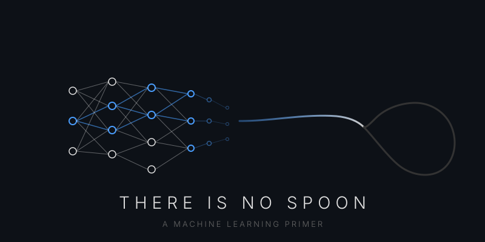

# There Is No Spoon



A machine learning primer built from first principles.
Written for engineers who want to reason about ML systems the way they reason about software systems.

<br>

## 🎯 Who This Is For

You're a strong engineer. You can draw a software system on a whiteboard from your own hard-earned mental model. You understand tradeoffs — maintenance vs elegance, performance vs complexity.

You have a gut for software design. **You don't have that gut for machine learning yet.**

You know the tools exist but you can't feel when to reach for which. This primer builds that intuition.

<br>

## 💡 What Makes This Different

This isn't a textbook or a tutorial. It's a **mental model** — the abstractions you need to reason about ML systems the way you already reason about software systems.

Every concept is anchored in **physical and engineering analogies**:
- Neurons as polarizing filters
- Depth as paper folding
- Gradient flow as pipeline valves
- The chain rule as a gear train
- Projections as shadows

These analogies aren't decorative — they're the primary explanation, with math as the supporting detail.

The focus is **when to reach for which tool and why** — not just what each tool does, but the design decision it represents and the tradeoffs it implies.

<br>

## 📐 What It Covers

The primer is organized in three parts:

<br>

🧱 **Part 1 — Fundamentals**

The neuron, composition (depth and width as paper folding), learning as optimization (derivatives, chain rule, backprop), generalization, and representation (features as directions, superposition).

🏗️ **Part 2 — Architectures**

The combination rule family (dense, convolution, recurrence, attention, graph ops, SSMs), the transformer in depth (self-attention, FFN as volumetric lookup, residual connections), encoding, learning rules beyond backprop, training frameworks (supervised, self-supervised, RL, GANs, diffusion), and matching topology to problem.

🚦 **Part 3 — Gates as Control Systems**

Gate primitives (scalar, vector, matrix), soft logic composition, branching and routing, recursion within a forward pass, and the geometric math toolbox (projection, masking, rotation, interpolation).

<br>

## 📖 Read It

The primer is a single markdown file with inline visualizations:

### **[ml-primer.md](ml-primer.md)**

<br>

Jump to a specific topic:

| | Topic | What it covers |
|---|-------|---------------|
| ⚡ | [The Neuron](ml-primer.md#-the-neuron) | Start here — dot product, bias, nonlinearity |
| 📄 | [Composition](ml-primer.md#-composition-depth-width-and-paper-folding) | What depth buys you — the paper folding model |
| 📉 | [Learning](ml-primer.md#-learning-as-optimization) | Derivatives, chain rule, backprop, loss landscape |
| 🎯 | [Generalization](ml-primer.md#-generalization) | Why overparameterized networks work at all |
| 🧠 | [Representation](ml-primer.md#-representation-what-networks-actually-store) | Features as directions, superposition |
| 🔀 | [Combination Rules](ml-primer.md#-the-combination-rule-family) | Convolution vs attention vs recurrence vs graph vs SSM |
| 🤖 | [The Transformer](ml-primer.md#-the-transformer) | Self-attention, FFN, residual connections |
| 🏋️ | [Frameworks](ml-primer.md#%EF%B8%8F-frameworks) | Supervised, self-supervised, RL, GANs, diffusion |
| 🗺️ | [Topology](ml-primer.md#%EF%B8%8F-topology-for-the-problem) | Matching architecture to problem — worked examples |
| 🧩 | [Design Patterns](ml-primer.md#-design-patterns) | Common problems → which tool to reach for |
| 🚦 | [Gates](ml-primer.md#-gates-as-control-systems) | The practitioner's gating and control toolkit |
| 🔧 | [Diagnostics](ml-primer.md#-appendix-diagnosing-and-fixing-training-problems) | Loss curve symptoms, sanity checks, LR tuning |

<br>

The syllabus shows the full topic map: **[SYLLABUS.md](SYLLABUS.md)**

<br>

### 🔬 Companion: Circuits and Formation

### **[circuits-primer.md](circuits-primer.md)** · [📄 PDF](https://github.com/dreddnafious/thereisnospoon/releases/latest/download/circuits-primer.pdf)

Picks up where the main primer stops: how the parts of a trained network actually talk to each other, and how working functions form during training.

| | Topic | What it covers |
|---|-------|---------------|
| 🚌 | [The Machinery](circuits-primer.md#part-1--the-machinery) | The residual stream as a shared bus, read/write as matrix products, Q/K/V from scratch, induction circuits, circuit roles |
| 🌱 | [Formation](circuits-primer.md#part-2--formation) | Function vs foothold, co-growth (why capabilities appear suddenly), the largest-leap rule, present vs reachable |
| ⬆️ | [Depth](circuits-primer.md#part-3--depth-what-a-fixed-stack-can-route) | What a fixed stack can route, chain of thought's two routes, recurrence |
| 🧪 | [Not Fooling Yourself](circuits-primer.md#part-4--not-fooling-yourself) | Encoder credit, the bitter-lesson check, probes in small worlds |
| 📡 | [One Training Step](circuits-primer.md#part-5--how-much-can-one-training-step-teach) | What a backward pass can teach, and where SGD throws it away |

<br>

## 🧭 How to Use This

This primer was built through conversation — one concept at a time, each stress-tested with questions until the mental model held up. You can use it two ways:

<br>

**📚 Solo reading**

Read it front to back, section by section. When something doesn't click, stop and re-read the section it depends on.

The primer is designed so that each section builds load-bearing intuition for the next. Don't skip ahead — the later sections assume you've internalized the earlier ones, not just read them.

<br>

**💬 Interactive exploration with an AI agent**

This is the more powerful approach, and closer to how the primer was actually built. Feed the primer (or a section of it) to your preferred AI coding assistant and explore it conversationally:

```
Read ml-primer.md. I'm an engineer learning ML fundamentals.
Walk me through the section on [topic]. I want to understand
it well enough to reason about design decisions, not just
recite definitions. Push back if I get something wrong.
```

Ask "why" questions. Propose wrong answers and see if the agent catches them. Ask for concrete examples. Ask what would happen if you changed one thing. Ask how two concepts relate.

The primer gives both you and the agent a shared vocabulary and a correct conceptual framework — the conversation fills in everything a static document can't.

> The primer is the map. The conversation is the territory.

<br>

## 🖼️ Visualizations

12 figures in the main primer, covering neurons, activation functions, paper folding, derivatives, chain rule, attention, FFN volumetric lookup, residual connections, dot products, loss landscapes, combination rules, and gating operations.

13 more in the companion (13–25): the residual bus, virtual weights, Q/K/V, induction, superposition crosstalk, circuit roles, co-growth dynamics, staggered formation, a measured leap-complexity experiment, shared vs private wiring, chain of thought's two routes, encoder credit, and the gradient as a dyad. Several are live computations rather than diagrams.

All generated from Python scripts in [`scripts/`](scripts/). To regenerate:

```bash
python3 scripts/01_neuron_hyperplane.py
python3 scripts/02_activation_functions.py
# ... etc
```

Requires `matplotlib` and `numpy`. The companion PDF is published as a [release asset](https://github.com/dreddnafious/thereisnospoon/releases/latest), not committed. To rebuild it: `python3 scripts/build_circuits_pdf.py` (also needs `markdown`, Chrome/Chromium, and `pdftotext` for contents page numbers; typeset in IBM Plex).

<br>

## 📝 Origin

Built through an extended conversational exploration between a software engineer and Claude, where every concept was stress-tested through questions, analogies were iterated until they landed, and misconceptions were corrected in real time.

The result is closer to a distilled mentorship than a reference document.

<br>

## 🤝 Contributing

PRs welcome. The goal is high signal — if you can explain a concept more clearly, fix an error, or add a section that fills a gap, open a PR.

Keep the tone:
- Direct, concrete
- Analogies over notation
- When-to-use over how-it-works

<br>

## 📄 License

MIT
