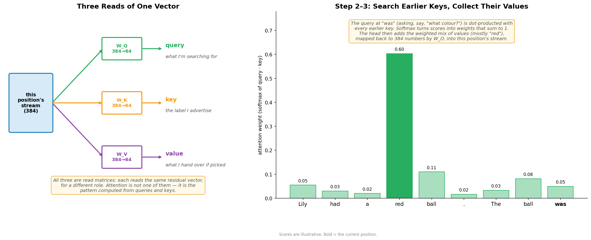
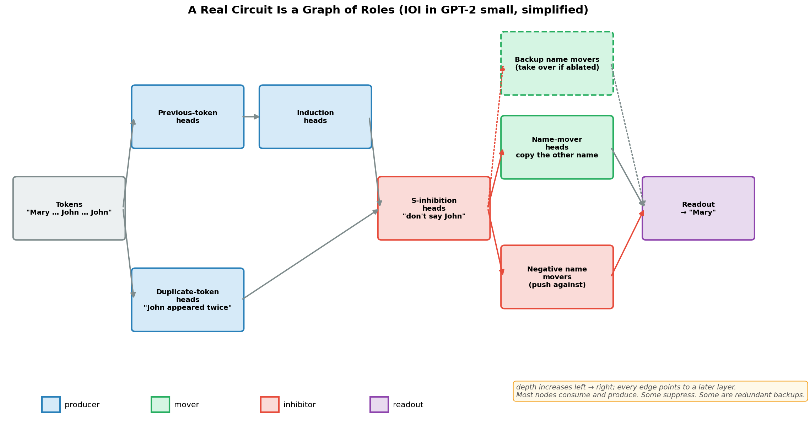
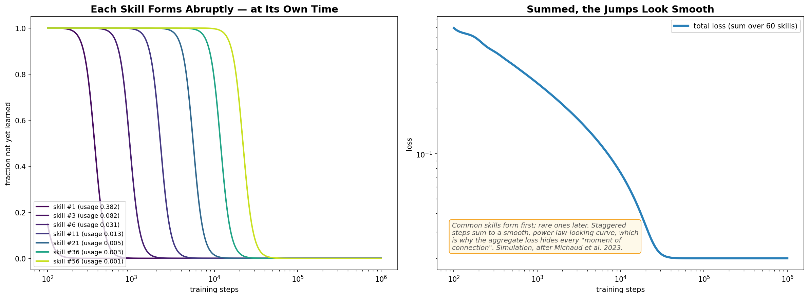
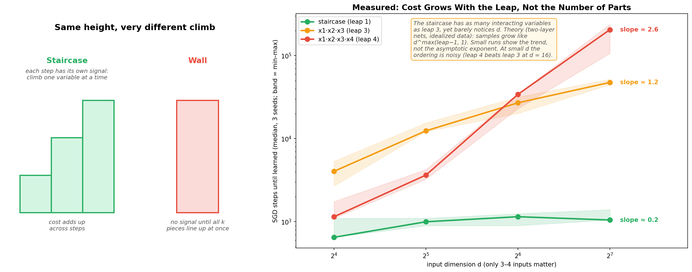
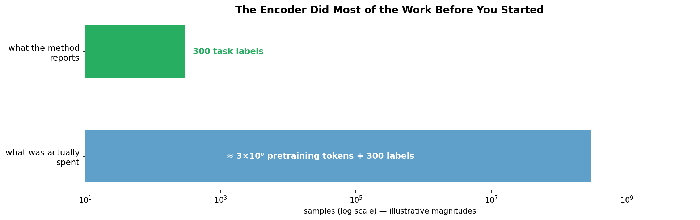

# Circuits and Formation: How Networks Grow Their Functions

*A companion to [ml-primer.md](ml-primer.md).*

The main primer explains what the parts of a network are and what each architectural choice assumes. This companion is about two questions that come up as soon as you try to reason about a trained model:

1. **How do the parts talk to each other?** What is physically shared, what is private, and what makes one component "connected" to another.
2. **How do working functions form during training?** Why some capabilities appear suddenly, why some never appear, and why a function that exists can still be useless.

> **How to read this.** Part 1 (the machinery) assumes the main primer's [Representation](ml-primer.md#-representation-what-networks-actually-store) and [Transformer](ml-primer.md#-the-transformer) sections. Part 2 (formation) needs Part 1 plus [Learning as Optimization](ml-primer.md#-learning-as-optimization). Parts 3 to 5 build on both. Each part ends with **Holds / Qualifiers**: the places where the simple picture needs care. The goal throughout is a mental model that survives contact with rigor.

<br>

### 📋 Running example

A small GPT-style model: **6 layers, 6 attention heads per layer, a 384-number residual stream, head size 64, MLP width 1,536.** Small enough to picture, and the same shape as much larger models.

---

<br>

# Part 1 — The Machinery

*What is physically inside a transformer, and how its parts talk to each other.*

## 🚌 The Residual Stream Is a Shared Bus

The main primer describes residual connections as a running sum of deltas: `x + Δ₁ + Δ₂ + …`. Here is what that implies for how components communicate.

At each token position there is **one vector**: 384 numbers. Every layer *adds* its output into that same vector:

```
h = embedding(token) + position          # the starting vector at this position
for each layer:
    h = h + attention(normalize(h))      # every head in the layer adds an update
    h = h + mlp(normalize(h))            # the MLP block adds an update
logits = unembedding(normalize(h))       # the output layer reads the final sum
```

There are no private wires between particular layers. There is one shared bus. **Every component reads the whole current sum, through its own read weights, and writes an update back into the same 384 dimensions.**


Three consequences:

- **Layer 30 can read what layer 3 wrote, directly.** The layers in between don't have to pass it along. They add their own writes on top, which can crowd it, and each block normalizes before reading. So: mostly independent, not perfectly.
- **The arrow of depth is strict.** A block can only read what was written below it. Nothing flows back down (Part 3).
- **Directions have no built-in meaning.** A direction "means" something only by a convention between whoever writes along it and whoever reads along it. Token embeddings are the one convention fixed at the start. Every other convention is negotiated by training.

**Two analogies that hold up.**
- *A shared radio band.* Writers broadcast on directions the way stations broadcast on frequencies. A reader tunes in by aligning its read weights with a direction. Orthogonal directions don't crosstalk. Where it breaks: nothing oscillates. It's geometry, not time.
- *A vector-symbolic (hyperdimensional) memory.* Writing is bundling (adding vectors). Reading is a dot product with a key direction. Many nearly orthogonal directions coexist in one vector, and keys aren't guaranteed unique, so collisions cause crosstalk. From the database side: a key-value store where keys are directions, not entries, and every lookup is approximate.

<br>

## 🧩 Components: Who Is on the Bus

| Term | Meaning |
|---|---|
| **Residual stream** | the running-sum vector at each position |
| **Component** | one unit that reads the stream and writes back: each **attention head**, each **MLP block** (sometimes analysed down to single **neurons**) |
| **Embedding** | writer only: token → starting vector |
| **Unembedding** (output head) | reader only: final vector → next-token scores |
| **Feature** | a direction (or small subspace) carrying one piece of meaning, e.g. "the previous token was *Harry*" |
| **Circuit** | a set of components that together implement a behaviour; can span many layers |
| **Path** | one route from a writer, through the stream, to a reader |

**"Head" means two unrelated things.** The *output head* is the single readout at the top. An *attention head* is one of several small parallel attention units **inside every layer**. Our model has 6 per layer, 36 in all, all in the middle of the network. When interpretability work says "the induction circuit is two heads in two layers", it means two internal attention heads.

**Where the classic neuron picture lives.** An MLP block *is* the dense layer you know: 384 → 1,536 neurons with a nonlinearity → back to 384. What's different in a transformer is the wiring *between* blocks. A block's output isn't fed only to the next block; it's added to the shared stream.

**Who moves information sideways.** MLP blocks work on each position separately. **Attention heads are the only components that move information between positions.**

<br>

## 📻 Reading and Writing: Tuning a Receiver

A component doesn't read the stream with a single vector. It reads through a **matrix** that projects the 384 numbers down to a smaller space, and writes back through another matrix.

- An MLP block reads with a 384 → 1,536 matrix and writes with a 1,536 → 384 matrix.
- An attention head reads with three 384 → 64 matrices (query, key, value) and writes with one 64 → 384 output matrix.

**The edge between two components is the product of the writer's write matrix and the reader's read matrix.**
- *For one direction* it's a dot product. If a writer writes along **w** and a reader reads along **r**, the reader receives **r · w**. Aligned: loud. Orthogonal: silent.
- *In general* it's a matrix product. If head A writes through its output matrix and head B reads its keys through its key matrix, then everything A can send to B's keys is the small matrix `W_K(B) · W_O(A)`. These products are called **virtual weights**. Their relative size is a **composition score**.


> **Key insight:** every component *can in principle* read anything written earlier. An edge exists only where training has aligned the reader's read matrix with the writer's write directions. "Connected" is something learned, not something wired in.

<br>

## 🔍 Query, Key, Value: Three Reads of One Vector

The main primer gives attention's one-liners: query = "what am I looking for", key = "what do I contain", value = "what do I provide". Here is the mechanism under them.

**Step 1.** Every position computes three small vectors *from its own residual vector*, each by a different 384 → 64 matrix:
- **query** = `W_Q × stream`: *what I'm searching for*
- **key** = `W_K × stream`: *the label I advertise to anyone searching*
- **value** = `W_V × stream`: *the content I hand over if someone picks me*

All three are read matrices: they read the same residual vector for three different roles.

**Step 2.** The current position compares its *query* with the *key* of every earlier position (dot products), and softmax turns the scores into weights that sum to 1. That weighting is the **attention pattern**: *where* the head looks. Attention is not a read matrix; it's what you get from queries and keys.

**Step 3.** The head takes the weighted mix of those positions' *values*, maps it back to 384 numbers with its output matrix, and adds it to this position's stream.



**A library analogy.** The query is the question you walk in with. Keys are the titles on the spines. Values are the books' contents. You compare your question with every title, and read the contents of the books whose titles match.

**Composition: three ways one head can depend on another.** A later head can be shaped by an earlier head's output through any of its three reads:
- **Q-composition:** what it *searches for* depends on an earlier head
- **K-composition:** how earlier positions *label themselves* depends on an earlier head
- **V-composition:** what *content gets carried* depends on an earlier head

<br>

## 🔗 Induction: the Canonical Two-Part Circuit

**Induction** is the in-context trick "A B … A → predict B". Having seen "Harry Potter" once, after the next "Harry" predict "Potter". It takes two heads in different layers:

1. **A previous-token head (earlier layer)** writes into each position "the token before me was X". At "Potter" it writes "previous token was *Harry*". It predicts nothing by itself.
2. **An induction head (later layer)**, at the second "Harry":
   - its *query* asks "find a position whose previous token was *Harry*";
   - each earlier position's *key* is built from the previous-token head's note. The key at "Potter" says "my previous token was *Harry*": a match. **That is K-composition.**
   - the *value* at "Potter" says "my token is *Potter*". It's copied forward, and the output predicts "Potter".


**The capability exists only in the composition.** Remove either head and induction disappears. A one-layer attention-only model can't do it at all, because there's no second layer to consume the first one's note.

> **Key insight:** the name "induction head" names the consumer, but **the function is the producer–consumer pair.** A producer with no consumer is worth nothing, however well it works.

<br>

## 🧠 Crowded but Not Colliding

The main primer covers [superposition](ml-primer.md#superposition): more features than dimensions, packed to minimize interference. Two numbers make it concrete:

- **Random directions in high dimensions are nearly orthogonal.** Typical overlap shrinks like 1/√d. In 3-D, random directions overlap a lot; in 384-D they almost never do.
- **Crosstalk depends on how many features are on at once.** Pack 4,000 features into 384 dimensions and read one back by dot product. With a few active features the readout is clean. With hundreds active, the small overlaps add up and swamp it.


So the accurate word is **nearly orthogonal**. It works because networks superpose features that are **rarely active together** (sparse), and use nonlinearities to threshold away small interference. Some heads and MLPs even **erase**: they write negative copies to clear space on a crowded bus. When it fails you get **polysemanticity**: one neuron or direction serving unrelated features.

**Two kinds of interference, often confused.** *Representational* interference is superposition crosstalk. *Training* interference is functions competing for gradient or capacity while they're being learned (Part 2). Same word, different mechanisms.

<br>

## 🕸️ Circuits Are Graphs of Roles

Real circuits are directed graphs with fan-in, fan-out and a lot of reformatting, and most nodes both consume and produce. Roles you'll see:

- **Producers / detectors** write a feature ("this token repeated", "the number 7 as an angle").
- **Movers / translators** move information between positions (attention) or reformat it (MLPs). **A lot of a circuit is plumbing, not computation.**
- **Combiners** need two inputs at once (fan-in), like an AND over two producers.
- **Inhibitors** suppress competing answers. This is how paths compete.
- **Readouts** are the final consumers.

**Example: indirect-object identification.** "When Mary and John went to the store, John gave a drink to ___" → "Mary". The circuit found in GPT-2 small: duplicate-token heads notice "John" appeared twice; S-inhibition heads carry "don't say John"; name-mover heads copy the remaining name; negative name movers push against the answer; backup name movers take over when the main ones are removed.



**Example: modular addition.** In the well-studied "clock" solution, the embeddings write a and b as points on circles (cos and sin at a few frequencies). The middle combines them with trig identities: cos(a)cos(b) − sin(a)sin(b) = cos(a + b) composes two rotations. The readout checks which answer lines up. The network adds by rotating.

<br>

### Holds / Qualifiers — Part 1

- **Holds:** one shared stream; reading and writing as matrix products; edge strength as read × write; the two-head structure of induction; strictly upward edges.
- **Qualifier:** "reading is subspace overlap" is the first-order, linear picture. Reads go through normalization, and MLP readers are nonlinear. Some features aren't single directions: days of the week and months sit on circles.
- **Qualifier:** "adds by rotating" is one implementation. Different training setups (mainly hyperparameters and architecture) find a different algorithm ("pizza") or mixtures.
- **Qualifier:** circuit diagrams explain much, not all, of a behaviour. Real computation is more distributed and redundant, and large models often hold several circuits for one capability.

---

<br>

# Part 2 — Formation

*How gradient descent grows working functions in that machinery, and what makes it hard.*

## 🧗 Function vs Foothold

Two things that are easy to blur:

- **A function is in the network.** A mechanism that, for every input, produces the right intermediate: "given *ball* and *pie*, produce *red*". It is built.
- **A foothold is in the data.** A statistical hint that gives the gradient a direction before any mechanism exists: "when the input mentions a ball, the answer is 3 a quarter of the time instead of a tenth". Nothing is computed; it's a correlation the gradient can start climbing.

Think of a climbing wall. Footholds are features of the rock. The function is the route you've learned to climb.

**Where they meet:** from a downstream component's point of view, **an upstream function that already exists and is readable is the best possible foothold.** If the intermediate sits on the bus in a form the reader can use, the downstream step becomes a simple lookup with a strong gradient, instead of a deep composite with almost none.

**When upstream functions *don't* help.** Train a set of primitive functions perfectly, each on its own prompts, then train a task that composes them. Often the primitives contribute nothing. Two mismatches explain it:
- *Context.* The primitive learned "compute this for *this kind* of input". On the composite's inputs it never runs.
- *Reader.* The primitive's consumer was trained to read its input as a *word* entering at the bottom of the network. In the composite, that input would arrive as a hidden vector partway up. The consumer's read weights were never aligned to where it would be written: a socket nobody plugs into.

**When they do help: the adapter case.** Train early layers to compute the intermediates *on the task's own inputs*, freeze them, add layers on top. The new layers converge much faster: same context, and they're trained to read exactly what the frozen layers write. (The main primer's [Transfer Learning](ml-primer.md#transfer-learning) section covers why unfrozen transplants get destroyed.) Caveats: freezing locks in *your* decomposition, and "readable" means readable by the kind of layer you add.

<br>

## 🔊 Co-Growth: Why Composed Functions Appear Suddenly

A composed function has parts that only pay off together. The mechanics:

- **It's multiplicative.** The output depends roughly on the *product*: how well the downstream part reads × how well the upstream part produces. **The gradient each part receives is scaled by how good the other part already is.** Early on both are small, so each gives the other only a tiny nudge. That's the plateau (mathematically, a saddle).
- **The escape compounds.** Any small alignment grows the other side's gradient, which grows its alignment, which feeds back. Once it starts, growth is roughly exponential. Nothing switches on; a feedback loop crosses into self-reinforcement.

**Analogy: audio feedback.** A microphone and a speaker. Below a certain gain, nothing happens. Nudge it past that threshold and the loop howls. The plateau is sub-threshold gain. The jump is the howl.


So composites are **grown, not assembled**. Both sides grow toward each other from weak beginnings. The progress during the plateau is real and measurable. A probe on the producer sees it coming long before the output moves.

**What this explains:**
- **Footholds** give one side a nonzero starting strength for free.
- **Intermediate supervision** gives each part its own target, so neither waits on the other.
- **Separately trained primitives** are aligned to the wrong reader: strong alone, but no candidate recipient for their output.

> **Key insight:** the lever for faster formation is not imposed structure. It's **raising the starting alignment between parts that must co-evolve**: through data with footholds, targets for intermediate steps, or initialization.

<br>

## 📈 What Forms When

If you train normally on a problem you believe decomposes into N functions, the general shape is known. The specifics aren't.

1. **Shortcuts first.** The cheapest partial correlation wins early. Grokking's memorization phase is one example.
2. **Components roughly in order of signal strength and frequency.** Strong, common, easy-to-reach pieces form first; SGD learns functions of increasing complexity.
3. **Composed pieces: plateau, then jump.** Induction heads form abruptly in a visible phase change.
4. **In big models the jumps overlap.** Many small skills each form fairly abruptly, at staggered times, roughly in order of how often they're used. The aggregate loss looks smooth because the jumps are spread out.



**Don't assume the network uses *your* decomposition.** On modular addition, different setups find different algorithms. Being sure a problem decomposes into N functions doesn't mean the network will find those N.

<br>

## 🪜 The Largest Leap Sets the Cost

The difficulty of a task isn't driven by the total number of parts that have to align. **It's driven by the largest group that must align at the same time with no intermediate signal.**

- **A staircase** is a chain where each new variable has its own signal: climb one step at a time, and the cost roughly adds up across steps.
- **A wall** is a step where k pieces must all line up before any signal appears. Parity of k bits is the extreme case: it correlates with no smaller subset.

The theory has a name for this: **leap complexity**. For SGD on two-layer networks, the samples needed grow like **d^max(leap − 1, 1)**, where d is the number of candidate inputs. A related result, the **information exponent**, gives d, d·log d, or d^(k−1) depending on the order k of the first correlation between input and target.

The experiment below is real. A two-layer network has to find 3–4 relevant inputs among d. On a log-log plot of steps against d, the fitted slopes are:
- **staircase: about 0.2.** It has as many interacting variables as the leap-3 target, yet barely notices d.
- **leap 3: about 1.2.**
- **leap 4: about 2.6.**

The ordering matches the theory's prediction, and the slopes head toward its exponents of 2 and 3. Small runs show the trend, not the asymptote. At d = 16 the ordering is even noisy: leap 4 beats leap 3.



**Rule of thumb:** cost ≈ the sum over steps of d^(that step's leap − 1), dominated by the largest leap.
- *Fan-in* of k inputs with no signal from any smaller subset is a leap of k.
- *Fan-out* doesn't raise the leap. It may lower the effective cost, by giving a producer gradient from more readers.

> **Key insight:** everything that helps composition (footholds, intermediate targets, writing steps out as tokens) works the same way: **it breaks big leaps into small ones.** A task is hard not because it has many parts, but because many parts pay off only together.

<br>

## 🔌 Present Is Not Reachable

A producer is worth something only if something reads it:
- **A producer can have value without *this* consumer, but not without *any* consumer.**
- **One producer can serve many consumers.** That's reuse, and it's where the economy comes from.
- **The unit that matters is the path, not the node.** Counting which functions are *present* overstates capability. The faithful measure is how many producer→consumer connections carry signal that downstream computation uses. Interpretability measures it with **path patching**: intervene on one edge and see whether behaviour changes.

> **Key insight:** capability = functions present **and** reachable.

**Where conditioning enters decides sharing.** Here is a small toy, trained from scratch. A shared intermediate z = I(a, b) over 100 input pairs is read by k "consumer" tasks. Each consumer trains on half the pairs, and is tested on the pairs only *other* consumers trained on. It can only get those right by reading an intermediate someone else built.


- **Shared trunk + per-task heads:** about 98% transfer at k = 8. Weight decay mattered (69% without it).
- **Task identity given at the input:** 12–18%, near chance. The network built private lookups.

Read this honestly. The positive arm is **close to forced by the wiring**: the trunk never sees the task, so every head reads the same representation. That's ordinary hard parameter sharing in multi-task learning. The informative half is the negative one: **given the freedom to share, plain gradient descent built private paths instead.** The lesson isn't "build explicit interfaces"; that's imposed structure, and the [bitter lesson](#-the-bitter-lesson-check) warns against it. The lesson is a question: what pressure makes an *unconstrained* network share? (For composition, recurrence plus long training is one known answer; see Part 3.)

<br>

## 🧭 Where Good Intermediates Come From

The leap rule says: break big leaps into small steps. Someone has to know the steps. Routes, from most imposed to most discovered:

1. **Human-specified.** Label the intermediates, or annotate step-by-step solutions. Effective and costly, and you must already know the decomposition.
2. **Language as a ready-made library.** Words are pre-aligned intermediate variables that every component already reads. Plausibly a big part of why chain of thought works: the vocabulary *is* a huge staircase someone else built.
3. **Self-discovered by outcome reward.** The model samples its own intermediate steps, and only the ones that lead to verifiably correct answers are reinforced (STaR; today's RL-trained reasoning models). Scalable.
4. **Discovered inside the network.** Find the variables the network already computes (sparse autoencoders, causal abstraction) and use them.
5. **Discovered by compression across tasks.** Keep the sub-programs that shorten many solutions (DreamCoder). An intermediate reused across many tasks is probably a real one.

> **Key insight:** a good intermediate has **many consumers.** It shortens many tasks, it gets gradient from all of them, and it's a foothold for whatever is built on it next.

<br>

### Holds / Qualifiers — Part 2

- **Holds:** function vs foothold; co-growth as the mechanism of sudden composition (exact for deep linear networks, empirically supported elsewhere); the largest-leap rule (proven in simplified settings); capability on paths.
- **Qualifier:** the leap and information-exponent results are proven for two-layer networks on idealized data, not for transformers on text. The trend carries over qualitatively; the exponents for real models aren't known.
- **Qualifier:** "producers with many consumers form earlier" has indirect support: shared pathways win a race for learning, and mixing tasks shortens plateaus. But no study has yet measured fan-out against formation time directly. Treat it as a hypothesis.
- **Qualifier:** functions trained together sometimes crowd each other out at low data, but well-tuned joint training often interferes little.

---

<br>

# Part 3 — Depth: What a Fixed Stack Can Route

*What a fixed-depth network can and can't compute, and what chain of thought and recurrence change.*

## ⬆️ Every Edge Points Upward

In a standard transformer, each layer reads only lower layers' outputs. Attention across positions reads earlier positions at the same height, which is still below. So **the computation graph must fit in layer order.** The only route from a high layer back to a low one is through the output token (chain of thought), unless the architecture adds one: looped or recurrent-depth models (see the main primer's [Recursion Within a Forward Pass](ml-primer.md#recursion-within-a-forward-pass)).

<br>

## 📐 Representable vs Learned

Two separate questions: what *can* be represented with the right weights, and what gradient descent *finds*.

**Representable (largely proven):**
- Any acyclic graph whose longest path has k steps can be laid out in k layers. A fixed-depth network can implement it only if the longest path fits.
- Fixed-depth transformers with realistic precision sit in a weak parallel circuit class (TC⁰), so under standard assumptions they can't solve some inherently serial problems at any size.
- **Chain of thought lifts the limit.** With polynomially many generated steps, transformers can simulate any polynomial-time computation.
- **Looped transformers** can emulate a programmable computer. Recurrent networks are Turing complete in idealized settings.

**Learned (largely open).** Expressivity says the weights exist. Whether gradient descent finds them is a different question. One clear data point: on composing two facts that were never seen combined, vanilla transformers fail even after long training, while **recurrent-depth (looped) transformers learn systematic composition** through a late grokking stage, and extra loops at inference extend them to deeper chains.

<br>

## 📝 Chain of Thought: a Universal Port

| | Residual stream | Chain-of-thought token |
|---|---|---|
| Bandwidth | high: 384 continuous numbers | low: one of ~50k symbols, ≈ 15.6 bits |
| Who can read it | only readers trained to align with that direction | every component; reading words is what pretraining taught all of them |
| Where it lands | the next layer up, same position | the bottom (layer 0) of the next position |
| Noise | continuous; errors accumulate | snapped to a symbol, which corrects small errors |

- **A token is a universal port.** It uses the one convention every reader shares. That's why writing intermediate steps out as tokens is usually the cheapest way to make a composite learnable.
- **A token resets depth.** It re-enters at the bottom, so the computation can use every layer again.
- **The cost is bandwidth.**

Analogy: thinking on paper. You write down a partial result, then read it back with your whole mind, not just the part that produced it.

<br>

## 🛤️ Chain of Thought Has Two Routes

When a model generates text, it runs every layer at every position and keeps each position's intermediate states (the KV cache). An earlier generated token can affect later computation in two ways:

1. **The token route.** The top layer at position t produces a word, and that word is the *input* at t+1, entering at layer 0. **This adds depth:** T generated tokens give a path about T × 6 layers long.
2. **The hidden-state route.** Attention at layer L of position t+1 reads earlier positions' layer-L states: sideways, never down. **This adds width and storage, not depth.**


Evidence that separates the routes: models trained to use meaningless filler tokens ("......") can solve some tasks they fail without them (3SUM-style problems), through the hidden-state route. But learning to use filler needs dense, specific supervision, and in theory filler stays inside the fixed-depth class. Only real tokens carry a model past it.

<br>

### Holds / Qualifiers — Part 3

- **Holds:** strict upward edges in a standard transformer; the expressivity results; the two routes.
- **Qualifier:** expressivity results are worst-case statements about which weights exist, not about what training finds on real data.

---

<br>

# Part 4 — Not Fooling Yourself

*How to measure any of this without crediting the wrong thing.*

## 🏦 The Encoder Is the Ultimate Foothold

A pretrained encoder is the biggest foothold there is. An experiment that doesn't control for it gives the method credit for work the encoder already did. For example: before any task training, a linear probe on a pretrained small LM may already read a task-relevant variable at 99%. The encoder supplied that, not the method.



**Controls:**
1. **Random-initialization control.** Same architecture, no pretraining. Whatever the method still achieves is its own.
2. **Step-0 baseline.** Measure what's readable before training. Credit only the improvement.
3. **Probe control tasks.** Same inputs, random labels. How well a probe learns those measures the probe's own capacity, not structure in the representation.
4. **State the claim precisely.** "Method A beats B on the same encoder" is a fair relative claim. "Method A needs only N labels" is not a fair absolute one unless pretraining is on the books.

The honest unit for sample efficiency is **labels per new task, given an encoder that cost X.** A method that needs few labels on top of a huge encoder has *moved* the samples, not removed them. That can still be worth it, because pretraining is paid once and amortized.

<br>

## 🧱 The Bitter-Lesson Check

The same trap appears at the architecture level. If the structure you're testing for is built into the design (as with the shared trunk above, which can't see the task), finding it is not a discovery.

**The test:** *could you have predicted the result confidently from the architecture alone?* If yes, it's a ceiling or a control, not the experiment.

The larger pattern is the bitter lesson. Hand-built structure gives early wins and then plateaus. General methods that turn compute into capability keep scaling. So when an engineered piece of structure helps, the useful follow-up question is: what *rewarded* pressure would make the network build that structure on its own?

<br>

## 🔬 Probes Need Care in Small Worlds

With few distinct inputs (say 100 pairs), almost any lookup table is linearly decodable even before training. Probe results then need control tables. Stronger evidence comes from **causal** tests (ablation, cross-task patching) and **behavioural** ones (transfer to held-out combinations).

---

<br>

# Part 5 — How Much Can One Training Step Teach?

*An information-theoretic view of a backward pass: what it can carry, and where SGD throws it away.*

## 📡 The Budget

Given the weights and the input, the only new information in a backward pass is the label. So **one example teaches at most its surprisal, −log p(correct), which is its loss.** Over a training run, the information absorbed is bounded by the **prequential code length**: the sum of each example's loss at the moment it was trained on.

The loss is the information budget. An example the model already predicts well has almost nothing left to teach.

<br>

## 🕳️ Where SGD Throws It Away


1. **Batch averaging.** Per example, a weight matrix's gradient is one outer product, a **dyad**: `δ · aᵀ` (backward error × forward activation). A batch averages them and discards the rest, including how much the examples disagreed. Second-order optimizers (K-FAC, Shampoo, SOAP) keep running statistics of those factors. Analogy: a till that keeps the total and throws away the receipts.
2. **Tiny steps.** One step removes only a small fraction of an example's surprisal. The rest has to be re-extracted in later epochs, while other updates partly overwrite it.
3. **Saturation ("gradient starvation").** Once one feature explains an example, its gradient fades, and any *other* predictive feature in that example never gets a signal.
4. **Hard labels.** A one-hot target says only "not this" about every other output. Soft targets (distillation) carry more bits per example.

<br>

## 🤝 Examples Teach Each Other

A step on example A changes example B's loss by about −η·(g_A · g_B), where g is each one's gradient. Aligned gradients mean learning A teaches B. It also changes B's *gradient*, through curvature. Over many steps these cross terms don't cancel. Two analyses show this:
- the Reptile analysis: multi-step SGD implicitly maximizes the inner product between different minibatches' gradients;
- the implicit-regularization analysis of SGD: its effective loss includes a penalty on how much per-batch gradients disagree.

So **plain SGD has a built-in preference for parameters where examples agree**: shared structure, with nothing imposed. That's a bitter-lesson-compatible mechanism for the sharing Part 2 asked about.

> **Key insight:** the general data-efficiency methods each plug a leak. Distillation adds bits per example (leak 4). Ensembling averages out what single runs discard (leaks 1, 2). More epochs re-extract what small steps leave behind (leak 2). Heavy weight decay keeps the first feature to fit from locking in (leak 3). Combined at fixed data, with weight decay about 30× the usual default, they give about **5× data efficiency** in recent pre-training experiments.

---

<br>

## 🗝️ Key Insights

- The residual stream is one shared bus; "connected" means a reader's read matrix has been trained to align with a writer's write directions.
- Query, key and value are three reads of the same vector; attention is the pattern queries and keys produce.
- A capability usually lives in a producer–consumer pair, not in one component. Name the pair, not the head.
- Superposition works because features are sparse. Crosstalk grows with how many are on at once.
- Footholds are in the data; functions are in the network. A readable upstream function is the best foothold a downstream one can have.
- Composed functions are grown, not assembled. Each part's gradient is scaled by the other's strength, so they plateau together and then jump.
- Cost is set by the largest leap, not the number of parts. Everything that helps composition breaks big leaps into small ones.
- Present is not reachable. Count paths, not nodes.
- Where conditioning enters decides whether a network shares or builds private lookups. Imposed sharing isn't discovered sharing.
- A fixed stack can only route what fits in its depth. Chain-of-thought tokens are a universal port and the only route back down.
- Pretrained encoders and built-in structure both take credit quietly. Control for them.
- One example can teach at most its loss. SGD throws some of that away; the general data-efficiency methods each recover part of it.

---

<br>

## 📚 References

Checked 2026-11-20. arXiv ids where available.

**Machinery**
- Elhage et al. 2021. *A Mathematical Framework for Transformer Circuits.* Transformer Circuits Thread. (residual stream, virtual weights, Q/K/V-composition)
- Olsson et al. 2022. *In-context Learning and Induction Heads.* arXiv 2209.11895.
- Elhage et al. 2022. *Toy Models of Superposition.* arXiv 2209.10652.
- Engels et al. 2025. *Not All Language Model Features Are One-Dimensionally Linear.* ICLR. arXiv 2405.14860.
- Wang et al. 2023. *Interpretability in the Wild: a Circuit for Indirect Object Identification in GPT-2 small.* ICLR. arXiv 2211.00593.
- Nanda et al. 2023. *Progress Measures for Grokking via Mechanistic Interpretability.* ICLR. arXiv 2301.05217.
- Zhong et al. 2023. *The Clock and the Pizza.* NeurIPS. arXiv 2306.17844.

**Formation**
- Saxe, McClelland, Ganguli 2014. *Exact Solutions to the Nonlinear Dynamics of Learning in Deep Linear Neural Networks.* ICLR. arXiv 1312.6120.
- Nakkiran et al. 2019. *SGD on Neural Networks Learns Functions of Increasing Complexity.* NeurIPS. arXiv 1905.11604.
- Michaud et al. 2023. *The Quantization Model of Neural Scaling.* NeurIPS. arXiv 2303.13506.
- Abbe, Boix-Adserà, Misiakiewicz 2022, 2023. *The Merged-Staircase Property* (COLT, arXiv 2202.08658); *SGD Learning on Neural Networks: Leap Complexity and Saddle-to-Saddle Dynamics* (COLT, arXiv 2302.11055).
- Barak et al. 2022. *Hidden Progress in Deep Learning: SGD Learns Parities Near the Computational Limit.* NeurIPS. arXiv 2207.08799.
- Ben Arous, Gheissari, Jagannath 2021. *Online SGD on Non-convex Losses from High-dimensional Inference.* JMLR. arXiv 2003.10409.
- Saxe, Sodhani, Lewallen 2022. *The Neural Race Reduction.* ICML. arXiv 2207.10430.
- Kim et al. 2025. *Task Diversity Shortens the ICL Plateau.* TMLR. arXiv 2410.05448.
- Merullo, Eickhoff, Pavlick 2024. *Circuit Component Reuse Across Tasks in Transformer Language Models.* ICLR. arXiv 2310.08744.
- Csordás, van Steenkiste, Schmidhuber 2021. *Are Neural Nets Modular?* ICLR. arXiv 2010.02066.
- Zelikman et al. 2022. *STaR: Bootstrapping Reasoning With Reasoning.* NeurIPS. arXiv 2203.14465.
- Ellis et al. 2021. *DreamCoder.* PLDI. arXiv 2006.08381.

**Depth**
- Merrill & Sabharwal 2023. *The Parallelism Tradeoff: Limitations of Log-Precision Transformers.* TACL. arXiv 2207.00729.
- Merrill & Sabharwal 2024. *The Expressive Power of Transformers with Chain of Thought.* ICLR. arXiv 2310.07923.
- Feng et al. 2023. *Towards Revealing the Mystery behind Chain of Thought.* NeurIPS. arXiv 2305.15408.
- Li et al. 2024. *Chain of Thought Empowers Transformers to Solve Inherently Serial Problems.* ICLR. arXiv 2402.12875.
- Giannou et al. 2023. *Looped Transformers as Programmable Computers.* ICML. arXiv 2301.13196.
- Pfau, Merrill, Bowman 2024. *Let's Think Dot by Dot.* COLM. arXiv 2404.15758.
- Wang, Yue, Su, Sun 2024. *Grokked Transformers are Implicit Reasoners.* NeurIPS. arXiv 2405.15071.
- Kohli et al. 2026. *Loop, Think, & Generalize: Implicit Reasoning in Recurrent-Depth Transformers.* arXiv 2604.07822.

**Hygiene and information**
- Hewitt & Liang 2019. *Designing and Interpreting Probes with Control Tasks.* EMNLP. arXiv 1909.03368.
- Blier & Ollivier 2018. *The Description Length of Deep Learning Models.* NeurIPS. arXiv 1802.07044.
- Pezeshki et al. 2021. *Gradient Starvation.* NeurIPS. arXiv 2011.09468.
- Smith, Dherin, Barrett, De 2021. *On the Origin of Implicit Regularization in SGD.* ICLR. arXiv 2101.12176.
- Nichol, Achiam, Schulman 2018. *On First-Order Meta-Learning Algorithms.* arXiv 1803.02999.
- Hinton, Vinyals, Dean 2015. *Distilling the Knowledge in a Neural Network.* arXiv 1503.02531.
- Kim, Kotha, Liang, Hashimoto 2026. *Pre-training under Infinite Compute.* ICLR. arXiv 2509.14786.

<br>

## 🖼️ Figures

Figures 13–25 are generated by the scripts in [`scripts/`](scripts/), with `matplotlib` and `numpy` only. Figures 14, 17, 19 and 25 are live computations; 21 is a real training experiment (a few minutes on a CPU; results are cached in `scripts/21_leap_staircase_results.json`); 22 plots results from a small toy run embedded in its script. The rest are diagrams or labelled illustrations.
